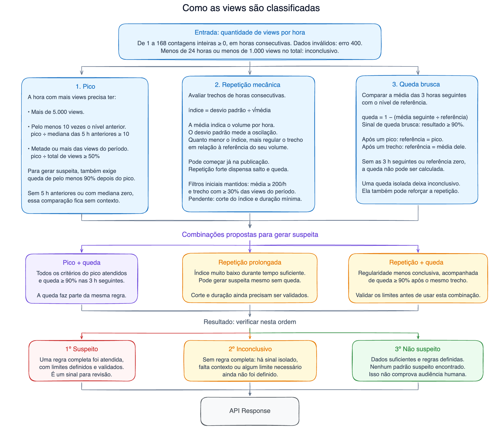

## Nota para quem avalia

Comece por `src/classifier.ts` (regras e motivos). Os cálculos ficam em `src/stats.ts`, o gerador em `src/dataset.ts` e as métricas em `src/evaluation.ts`. `npm run demo` mostra quatro casos pela API.

A API recebe views por hora e retorna `suspect`, `inconclusive` ou `not_suspect`, com motivo em português e sinais calculados. Detecta pico concentrado com queda e repetição, inclusive desde a publicação. Queda isolada fica inconclusiva. Um pico com crescimento anterior e cauda decrescente também fica inconclusivo, salvo se houver uma regra de repetição completa.

Com mais tempo, eu faria:
- Uso de sinais de engajamento se disponíveis
- Avaliação com séries reais rotuladas

Defini o escopo e a arquitetura e usei IA para implementar a API, criar os testes e gerar o dataset. Revisei o dataset para ampliar a variedade de cenários e analisei os falsos positivos e os casos em que o classificador prefere não acusar. Também ajustei as mensagens para tornar os motivos de cada classificação mais específicos.



## Limitações

- A proteção para virais curtos exige crescimento anterior e três horas de cauda decrescente; virais legítimos fora desse padrão ainda podem gerar falsos positivos. Suavização e arredondamento fazem legítimos parecer mecânicos (`smoothed_counts` e `rounded_plateau`). Bots que imitam crescimento e cauda orgânicos podem ficar inconclusivos ou passar; séries iguais sempre recebem a mesma resposta.
- A regra forte exige 18 horas; a outra, oito mais três posteriores. Ambas dependem do mínimo global de 24 horas.
- Alterar a janela muda a participação no total e pode mudar o resultado. Picos menores que o máximo podem escapar.
- Zeros de falha de coleta são indistinguíveis de zeros reais. A API não usa likes, comentários, compartilhamentos ou salvamentos.
- Sem autenticação, rate limit ou aprendizado automático. `suspect` pede revisão; `not_suspect` não garante audiência humana.

## Como rodar

Node 22.13 ou superior.

```bash
npm ci
npm test
npm run typecheck
npm run evaluate
npm run demo
npm run dev
```

A API roda em `http://127.0.0.1:3008`; `PORT` muda a porta. Não usa banco, serviços externos ou dados reais de redes sociais, nem armazena as séries recebidas.

`npm run evaluate` gera `data/dataset.jsonl` e `data/report.json`, sem alterar o README. `test/evaluation.test.ts` compara o bloco abaixo com a medição e falha se qualquer número divergir.

## Resultado no dataset

<!-- evaluation:start -->
Taxa de falso positivo no dataset: **3,60% (19/528 casos legítimos)**.

Casos suspeitos sinalizados: **39,58% (95/240)**.

Resultados inconclusivos: **342/768**.

| Cenário | Rótulo | Suspeitos / total | Inconclusivos | Falso positivo | Detecção |
| --- | --- | ---: | ---: | ---: | ---: |
| steady_small | legítimo | 0/48 | 0 (0,00%) | 0,00% | — |
| steady_viral | legítimo | 0/48 | 0 (0,00%) | 0,00% | — |
| organic_wave | legítimo | 0/48 | 0 (0,00%) | 0,00% | — |
| organic_launch | legítimo | 0/48 | 0 (0,00%) | 0,00% | — |
| organic_flash | legítimo | 0/48 | 48 (100,00%) | 0,00% | — |
| smoothed_counts | legítimo | 10/48 | 26 (54,17%) | 20,83% | — |
| rounded_plateau | legítimo | 9/48 | 35 (72,92%) | 18,75% | — |
| collection_gap | legítimo | 0/48 | 48 (100,00%) | 0,00% | — |
| daily_cycle | legítimo | 0/48 | 0 (0,00%) | 0,00% | — |
| early_peak | legítimo | 0/48 | 48 (100,00%) | 0,00% | — |
| low_activity | legítimo | 0/48 | 48 (100,00%) | 0,00% | — |
| bought_peak | suspeito | 40/48 | 5 (10,42%) | — | 83,33% |
| mechanical_launch | suspeito | 4/48 | 39 (81,25%) | — | 8,33% |
| mechanical_block | suspeito | 37/48 | 11 (22,92%) | — | 77,08% |
| short_mechanical_block | suspeito | 14/48 | 34 (70,83%) | — | 29,17% |
| disguised_bots | suspeito | 0/48 | 0 (0,00%) | — | 0,00% |
<!-- evaluation:end -->

Falso positivo é a proporção de legítimos classificados como `suspect`. Detecção é a proporção de suspeitos sinalizados. Os denominadores incluem todos os casos de cada rótulo, inclusive os inconclusivos.

Os 19 falsos positivos incluem 10 relatórios suavizados e 9 patamares arredondados. Os 48 eventos orgânicos curtos ficam inconclusivos. Dos 240 suspeitos, 145 escapam, incluindo os 48 bots com curva orgânica. As taxas valem apenas para este dataset.

A seed `20261011` gera 48 séries em cada um dos 16 cenários. Esse peso igual facilita a comparação, sem representar a frequência real. Os rótulos vêm da simulação, sem consultar o classificador. Contagens naturais usam Poisson para médias abaixo de 50 e aproximação normal nos volumes maiores.

Os blocos mecânicos cruzam durações de 7, 8, 9, 17, 18 e 19 horas com ruídos de 0,09, 0,11, 0,29 e 0,31, em dois volumes: 300 a 1.000 e 300 mil a 1 milhão de views/h. Os blocos curtos duram de 4 a 9 horas. Isso cobre os dois lados dos limites. Cada exemplo registra seus parâmetros; o ruído segue `√média × nível de ruído × amostra normal`, e amostragem e arredondamento alteram o índice medido.

Os legítimos incluem virais curtos com alturas e caudas variadas, médias móveis de 2, 4, 8 ou 16 horas, patamares arredondados para centenas, audiência estável, crescimento gradual, lançamento, ciclos diários, falhas de coleta e pouco volume.

## Critérios

Cada posição é uma hora consecutiva de views incrementais; zero é contagem conhecida, não uma hora ausente. Aceita de 1 a 168 inteiros não negativos, com valores e soma seguros em JavaScript. Menos de 24 horas ou menos de 1.000 views resulta em `inconclusive`.

### Pico

Avalia o maior pico, usando o primeiro em caso de empate. Exige todos estes critérios:

- Mais de 5.000 views
- `pico / mediana das 5 horas anteriores >= 10`
- `pico / total da série >= 0,5`
- `1 - média das 3 horas seguintes / pico >= 0,9`

Pico alto e concentrado sem contexto suficiente, ou com mediana anterior zero, fica inconclusivo. Se volume ou participação já descartam a regra, faltar histórico não impede um resultado não suspeito.

Mesmo atendendo aos critérios de pico, a série fica inconclusiva quando há contexto compatível com um viral orgânico:

- A hora imediatamente anterior tem pelo menos duas vezes a mediana das cinco horas anteriores.
- A primeira hora seguinte também tem pelo menos duas vezes essa mediana.
- As três horas seguintes diminuem estritamente: primeira > segunda > terceira.

A proteção exige mediana positiva e as três horas posteriores disponíveis. Ela impede acusar apenas pelo pico, mas uma regra de repetição completa ainda resulta em suspeita. Por exemplo, com mediana de 100 views, 200 views antes do pico de 12.000 e uma cauda de 200, 150 e 100, o resultado é inconclusivo se não houver repetição suspeita. Isso não comprova origem orgânica.

### Repetição

Examina trechos consecutivos de pelo menos seis horas, média mínima de 200 views/h e participação mínima de 30% no total. Usa desvio padrão amostral:

```text
média = soma das views do trecho / quantidade de horas
desvio padrão = √[soma de (views - média)² / (quantidade de horas - 1)]
índice de variação = desvio padrão / √média
```

| Regra | Duração mínima | Índice máximo | Exige queda depois? |
| --- | ---: | ---: | --- |
| Repetição forte | 18 horas | 0,1 | Não |
| Repetição com queda | 8 horas | 0,3 | Sim, pelo menos 90% |

A queda compara a média do trecho com as três horas imediatamente seguintes. Índice até 0,3 sem regra completa fica inconclusivo. A seleção prioriza regra forte, regra com queda e menor índice, mantendo o primeiro em empate. Só entram trechos com média e participação suficientes.

Em seis horas, `[199, 200, 201, 199, 200, 201]` tem índice aproximado de `0,063`, muito regular pela referência. `[998000, 1000000, 1002000, 998000, 1000000, 1002000]` tem `1,79`: amplitude de 0,4% não basta para acusar, nem apenas seis horas.

A raiz da média vem do [modelo de Poisson](https://www.itl.nist.gov/div898/handbook/eda/section3/eda366j.htm), com chegadas independentes e ritmo constante. Views reais podem ter correlação, tendências, arredondamentos e agregações. O índice é heurístico, sem probabilidade de fraude ou significância estatística garantida.

### Queda isolada e decisão

Em cada divisão da série, compara as médias das três horas anteriores e seguintes. Queda de pelo menos 90% fica inconclusiva; referência zero ou falta de horas posteriores impede o cálculo. Pico e repetição usam suas próprias referências.

A decisão segue esta ordem:

1. Amostra insuficiente: inconclusivo, mesmo com sinais calculados.
2. Pico completo sem contexto orgânico, ou repetição completa: suspeito, mesmo se outra regra estiver sem contexto.
3. Pico completo com contexto orgânico, sinal isolado ou contexto necessário ausente: inconclusivo.
4. Nenhum padrão: não suspeito.

## Escolha dos limites

`src/rules.ts` reúne os limites, as configurações comparadas e a escolha usada pela API. A calibração usa esse mesmo arquivo.

Os limites do pico são escolhas heurísticas desta implementação; o enunciado não define valores numéricos. `npm run calibrate` compara três configurações de repetição na seed de desenvolvimento `20261010`:

| Configuração | Forte: horas / índice | Com queda: horas / índice | Falsos positivos no desenvolvimento | Suspeitos sinalizados |
| --- | --- | --- | --- | --- |
| Sensível | 6 / 0,3 | 6 / 0,8 | 97/528 | 158/240 |
| Intermediária | 12 / 0,2 | 6 / 0,5 | 47/528 | 130/240 |
| Restritiva, usada na API | 18 / 0,1 | 8 / 0,3 | 19/528 | 87/240 |

O script busca maior detecção com até 3% de falsos positivos. Nenhuma opção atende esse teto no dataset atual. A restritiva tem 3,60% no desenvolvimento; seus limites de repetição foram mantidos. A proteção para virais curtos foi acrescentada após observar os erros nessas famílias sintéticas, inclusive na seed de avaliação. Estas taxas descrevem o dataset usado no desenvolvimento da solução e não são uma validação independente. As seeds usam amostras diferentes das mesmas famílias; ainda falta validação com dados reais.

## Exemplo de request e response

Com a API rodando, envie um pico concentrado:

```bash
curl -s -X POST localhost:3008/classify \
  -H 'content-type: application/json' \
  -d '{"views":[100,100,100,100,100,100,100,100,100,100,100,100,12000,100,100,100,100,100,100,100,100,100,100,100]}'
```

Resposta `200`, resumida ao pico:

```json
{
  "classification": "suspect",
  "reason": "Na hora 13, o pico teve 12.000 views: 120 vezes a mediana anterior, 83,916% do total e queda de 99,167% na média das 3 horas seguintes.",
  "total_views": 14300,
  "hours": 24,
  "signals": {
    "peak": {
      "hour": 12,
      "views": 12000,
      "baseline": 100,
      "ratio": 120,
      "share": 0.8391608391608392,
      "following_mean": 100,
      "drop": 0.9916666666666667,
      "previous_views": 100,
      "previous_ratio": 1,
      "following_views": [100, 100, 100],
      "following_ratio": 1,
      "declining_tail": false,
      "organic_context": false,
      "detected": true,
      "missing_context": false
    }
  }
}
```

A resposta inclui também `signals.repetition`, `signals.abrupt_drop` e `thresholds`. `repetition` mostra o melhor trecho elegível, mesmo sem acionar regra; `match` indica `strong`, `with_drop` ou `null`. Referências incalculáveis usam `null`, nunca `Infinity`.

Em `signals.peak`, `detected` indica que os critérios numéricos de pico foram atendidos. `organic_context` indica a combinação de crescimento anterior e cauda decrescente que impede acusar apenas pelo pico. `previous_ratio` e `following_ratio` comparam a hora anterior e a primeira posterior à mediana; `following_views` contém as até três horas posteriores disponíveis. `declining_tail` é `null` quando faltam horas. O limite de crescimento aparece em `thresholds.organic_context_ratio`.

`hour`, `start_hour`, `end_hour` e `after_hour` começam em zero; `end_hour` é inclusivo. O motivo conta a partir de um. `share` e `drop` são frações (`0.9` = 90%); `drop` negativo indica crescimento.

`GET /health` retorna `{"ok":true}`. JSON inválido ou valores fora do contrato retornam `400` com `error`; corpo acima de 16 KB retorna `413`.


